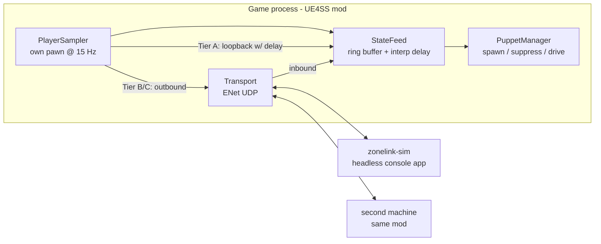
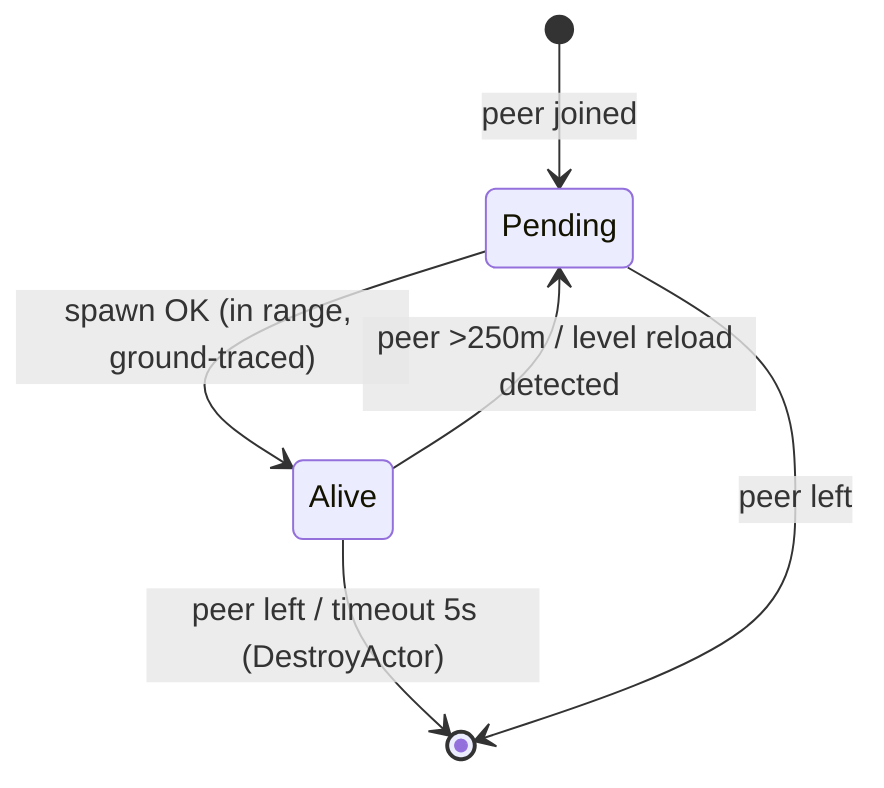

# ZoneLink — Phase 1: Presence

Design document for the first rung of the co-op MVP ladder: two or more players, each running
their own single-player session, see each other as stalker puppets with correct position,
locomotion animation, stance, and (spawn-time) weapon. No combat sync, no world sync.

Status: **Draft** · Depends on: nothing · Unblocks: Phase 2 (Combat)

---

## 1. Goal

A visitor connects to a host over LAN. Each side spawns a `BP_AI_Human_C` puppet for the other
and drives it from a ~15 Hz state stream. Walking, running, sprinting, crouching, and standing
around the campfire all read as "another stalker is here," sustained for a 30-minute session
with join/leave/rejoin.

### Non-goals (deferred)

| Deferred item                              | Lands in                             |
| ------------------------------------------ | ------------------------------------ |
| Damage, hit events, death                  | Phase 2                              |
| Live weapon-swap mirroring                 | Phase 1.5                            |
| NPC bubble sync, A-Life mute               | Phase 3                              |
| Clock/weather/emission sync                | Phase 4                              |
| PDA map markers for distant peers          | Phase 4                              |
| Steam lobbies / invites (LAN only for now) | later                                |
| Mission-protection policy gate             | Phase 2 (arrives with damage events) |

---

## 2. Architecture

The core trick that makes this testable with **one game copy**: the puppet driver never knows
where its data comes from. It consumes an abstract **StateFeed**; the feed can be filled by a
socket, a trace file, or the local player's own sampler on a delay.



### Test tiers (one copy → two copies)

| Tier             | Needs                            | Validates                                                                                                                            | Network                   |
| ---------------- | -------------------------------- | ------------------------------------------------------------------------------------------------------------------------------------ | ------------------------- |
| **A — Ghost**    | 1 game copy, pure Lua            | Puppet spawn stability, AI suppression, velocity-driven anim quality, A-Life reclaim behavior — i.e. **all the top game-side risks** | none (loopback buffer)    |
| **B — Sim peer** | 1 game copy + `zonelink-sim` exe | Wire protocol, jitter/loss handling, interp buffer, session handshake, timeouts                                                      | real UDP on localhost/LAN |
| **C — LAN**      | 2 machines, 2 licenses           | End-to-end, bidirectional, streaming edge cases                                                                                      | real                      |

Tier A is the deliberate first milestone: record your own run to a trace, then replay it into a
puppet offset +2 s / +3 m — you watch "yourself" jog through Zalissya. Zero sockets, zero C++.

> Do not plan on two game instances on one PC: Steam blocks the second launch and both would
> fight over `%LOCALAPPDATA%\Stalker2\Saved`. Tier C uses the second household machine.

---

## 3. Components

### 3.1 PlayerSampler

Samples the local player each tick window (target 15 Hz; decimate from per-frame):

| Field       | Source                                                           | Notes                                                           |
| ----------- | ---------------------------------------------------------------- | --------------------------------------------------------------- |
| pos         | `pawn:K2_GetActorLocation()`                                     | f32 ×3, cm                                                      |
| yaw / pitch | control rotation                                                 | yaw drives puppet facing; pitch reserved for aim offset later   |
| vel         | `CharacterMovement.Velocity`                                     | i16 ×3, cm/s — drives remote anim                               |
| stance bits | crouch / sprint / aim flags                                      | probe exact properties (P-5)                                    |
| weapon SID  | `CppMediator:GetPlayerItemInHandsData().MainHandItemPrototypeID` | sent on change only (reliable msg), hash in steady-state packet |

Cadence host: **C++ mod** uses `CppUserModBase::on_update()` (game thread, per frame — no
Lua-loop crash risk). **Lua Tier A** hooks a reliably-ticking UFunction instead (probe P-4);
never `LoopAsync` + `ExecuteInGameThread` per-frame (documented UE4SS registry-race crash).

### 3.2 StateFeed

Per-peer ring buffer of timestamped samples. Render target = `now − 120 ms`; linear interp
between bracketing samples; extrapolate ≤ 250 ms on gap, then freeze. Tier A fills it from the
local sampler with +2000 ms offset; Tier B/C from the socket.

### 3.3 PuppetManager

Lifecycle per remote peer:



- **Spawn**: probe ladder P-1 (below). Spawn position = first feed sample, Z-corrected by a
  `LineTraceSingle` down (same pattern as molotov splash patches).
- **Suppress AI**: probe ladder P-2. Target end state: controller brain stopped, no combat
  targeting, no pathfinding, movement fully external.
- **Protect**: puppet invulnerable (Phase 1 has no damage sync; a host-side mutant chewing the
  puppet must not kill it) and exempt from A-Life cleanup/offline conversion (P-3).
- **Faction**: puppet prototype must be neutral-stalker — a bandit-prototype puppet gets shot
  by the host's loyalists on sight (P-6).
- **Drive** (per frame, from interpolated target):
  - error = |target − actual|. **> 300 cm** → snap via `K2_SetActorLocationAndRotation`.
  - else velocity-match: set `CharacterMovement.Velocity` toward target (blend of positional
    correction + sampled vel) so the NPC's own locomotion AnimBP animates naturally.
  - yaw: set actor rotation yaw only. Stance: apply crouch state (P-5).
- **Level reload** (host quickloads, F8): all cached actor handles invalidate → detect via
  `IsValid` per frame, drop to Pending, respawn from feed. Same discipline as the molotov FP
  state cache.
- **Nameplate** (nice-to-have): `TextRenderComponent` attached above head; skip if friction.

### 3.4 Transport (Tier B+)

- Vendored **ENet** (1 reliable + 1 unreliable channel) inside a UE4SS **C++ mod**.
- Dedicated service thread → SPSC queue → drained in `on_update()` on the game thread.
  Outbound mirror: sampler enqueues, service thread sends. No game-thread socket calls.
- LAN discovery deferred; Tier B/C connect by IP (`zl_join <ip>` console verb / config file).
- Expect the Windows Firewall prompt on first listen; document for the kids' machines.

### 3.5 Session

- `HELLO{name, protoVer, charManifest}` → `WELCOME{peerId, peers[], clockSample}` →
  presence streaming. Reject on protoVer mismatch (fail loudly — family debugging).
- Peer timeout 5 s without packets → despawn + `PEER_LEFT` locally.
- Rejoin is just a fresh HELLO; no state carried.

---

## 4. Wire protocol (draft v0)

UDP, little-endian. One packet type dominates:

**PRESENCE** (unreliable, 15 Hz, ~34 B payload)

| Field      | Type   | Notes                                                     |
| ---------- | ------ | --------------------------------------------------------- |
| peerId     | u8     | assigned in WELCOME                                       |
| seq        | u16    | drop stale (wraparound-aware)                             |
| tMs        | u32    | sender clock, ms                                          |
| pos        | f32 ×3 | cm world space                                            |
| yaw, pitch | i16 ×2 | degrees ×182 (full i16 range)                             |
| vel        | i16 ×3 | cm/s                                                      |
| stanceBits | u8     | crouch, sprint, aim, …                                    |
| weaponHash | u32    | FNV-1a of SID; mismatch vs known → request WEAPON_CHANGED |

Reliable channel messages: `HELLO`, `WELCOME`, `PEER_JOINED`, `PEER_LEFT`,
`WEAPON_CHANGED{sid string}`, `PING/PONG` (clock offset, smoothed).

Bandwidth: 15 Hz × ~60 B framed × N peers — under 1 KB/s per peer. Irrelevant even on Wi-Fi.

The same payload layout **is** the trace-file record format, so the in-game recorder, the
Lua ghost replayer, and `zonelink-sim` all interoperate on one schema
(`src/zonelink/shared/protocol.h`, mirrored by a Lua serializer for Tier A).

---

## 5. zonelink-sim (the simulator)

Headless C++ console app sharing `protocol.h`. Modes:

| Mode                             | Behavior                                        | Exercises                                   |
| -------------------------------- | ----------------------------------------------- | ------------------------------------------- |
| `replay <trace> [--loop]`        | streams a recorded trace as a fake peer         | puppet driving under real UDP               |
| `orbit [--radius N]`             | synthetic figure-8 with stance toggles          | interp, stance application, no trace needed |
| `echo [--delay ms] [--offset m]` | mirrors your own outbound stream back as a peer | full duplex loop on one machine             |
| `record <out>`                   | logs your inbound stream to a trace             | sampler validation; builds fixture library  |
| `--jitter ms --loss pct`         | impairment flags on any mode                    | interp buffer / extrapolation tuning        |

This answers the "second copy" question: **everything except true bidirectional play is
developable against the sim.** Tier C is a validation pass, not a development dependency.

---

## 6. Risks and probes

Run against a **fresh F9 dump** (per-session) before writing puppet code. pcall cannot catch
native AVs — save before every spawn experiment; crash logs at
`%LOCALAPPDATA%\Stalker2\Saved\Crashes\<id>\Stalker2.log`.

| #   | Risk                                                                                                                | Probe                                                                                                                                                                                                             | Fallback ladder                                                                                   |
| --- | ------------------------------------------------------------------------------------------------------------------- | ----------------------------------------------------------------------------------------------------------------------------------------------------------------------------------------------------------------- | ------------------------------------------------------------------------------------------------- |
| P-1 | `BP_AI_Human_C` raw spawn = native AV (anomaly-spawn lesson: context-dependent actors crash)                        | grep dump: `XSpawn` verbs on `CustomConsoleManager` for an **NPC** spawn (items had `XSpawnItemNearPlayerBySID`; NPCs may too); else grep `SpawnNPC\|SpawnStalker\|CreateAgent\|Spawner` for a callable UFunction | ① console verb ② spawner-system UFunction ③ raw `SpawnActor` (save first, expect AV)              |
| P-2 | AI suppression surface unknown (GSC may use custom brain, not vanilla BT)                                           | dump the puppet's controller class; grep `BrainComponent\|StopLogic\|BehaviorTree\|RunBehaviorTree`                                                                                                               | ① `StopLogic` ② detach/UnPossess (watch anim deps) ③ feed AI a null objective                     |
| P-3 | A-Life reclaims puppet (offline conversion, corpse/far-NPC cleanup)                                                 | spawn ghost, walk 10 min incl. far excursion; watch for despawn                                                                                                                                                   | find keep-alive/important flag on NPC or its spawner record                                       |
| P-4 | Lua Tier A needs a per-frame/per-tick hookable UFunction (AnimBP hook failed before: no `BlueprintUpdateAnimation`) | grep fresh dump for `ReceiveTick` on player/HUD/controller BPs; verify `RegisterHook` fires                                                                                                                       | sample at lower cadence from an event that does fire; C++ `on_update()` makes this moot in Tier B |
| P-5 | Stance/crouch application on NPC (player-style `Crouch()` may not drive NPC AnimBP)                                 | inspect NPC AnimBP vars + movement component flags in live view                                                                                                                                                   | set AnimBP bool directly if exposed; accept stand-only ghost for first pass                       |
| P-6 | Puppet faction/relations (host NPCs aggro the puppet, or puppet auto-aggros)                                        | spawn near neutral camp, observe 5 min                                                                                                                                                                            | pick different prototype SID; look for relation-override function                                 |
| P-7 | Velocity-driven anim reads wrong (NPC locomotion keyed to AI intent, not velocity)                                  | Tier A ghost makes this visible in minutes                                                                                                                                                                        | drive via `AddMovementInput` on possessed-but-braindead controller instead                        |
| P-8 | UE4SS C++ mod toolchain vs experimental-latest (must build against the **exact** UE4SS commit = 3.0.1-1164)         | build hello-world C++ mod, verify `on_update` fires in-game before writing ENet code                                                                                                                              | pin commit; worst case stay Lua + localhost bridge exe (ugly, last resort)                        |

P-1/P-2/P-3/P-7 are the project's existential risks and **all four are retired by Tier A alone** —
before any networking exists.

### 6.1 Probe findings — static pass (2026-10-18, exe 2.0.6)

Sources: null-terminated ASCII scan of `Stalker2-Win64-Shipping.exe`
(`scripts/scan-exe-strings.ps1` → `build/exe-scan.txt`) + decoded cfg dive. No game session
needed for any of this.

**P-1 (spawn) — RESOLVED on paper.** `XSpawnObjBySID <SID>` exists: the generic counterpart of
the item spawn verbs, and NPCs _are_ ObjPrototypes — so the game's own spawn machinery (with
proper spawner context) is console-reachable. No raw `SpawnActor` needed. Also present:
`XSpawnDeadNpc`, `XSpawnPsyNPC`, `XSpawnALifeDirectorScenario`, `XSpawnItemContainer`.

**P-2 (AI suppression) — strong leads.** Vanilla BT stack confirmed in build (`BrainComponent`,
`StopLogic`, `RunBehaviorTree`, `BehaviorTreeComp`) **plus** GSC-specific `bLockAILogic` /
`UnlockAILogic` (property + paired unlock ⇒ designed freeze mechanism — try this first).
Verb-level: `XSetAIStayGoal`, `XResetAI`, `XActivateAIFeature`/`XDeactivateAIFeature`,
`XOverrideCombatTacticsInRadius`. Oddity worth a note: `XPossessToCharacterByUID` — the
engine exposes possession switching by UID (not needed for puppets, but proves controller
swapping is a supported game concept).

**P-3 (protection/reclaim) — verbs exist.** `XSetEntityUnkillableByUID`, `XSetGodModeByUID`,
`XProtectSquad`. UID addressing implied throughout (`XGetActorNameByUID`, `XSetDebugUID`);
in-game task: read the UID property off the spawned actor (NotifyOnNewObject on
`BP_AI_Human_C` fires at spawn, same pattern as the grenade hook).

**P-5 (stance) — full surface mapped.** `bWantsToCrouch`/`bIsCrouched`/`UnCrouch` (vanilla
CharacterMovement) plus S2's two-level system (`LowCrouch*` family, `CrouchToLowCrouch`,
`StandToCrouch` transitions). `OnRep_IsCrouched` present — crouch state is _replication-aware_
in the build (MP remnant; stance may propagate through vanilla rep plumbing on puppets).

**P-6 (faction/look) — RESOLVED.** Puppet prototype: **`GeneralNPC_Neutral_Stormtrooper`**
(ObjPrototypes.cfg; variants `_CloseCombat`, `_Recon`, `_Sniper`). Generic A-Life neutral
stalker: `Faction = Neutrals`, `UseGeneratedName = true` via `NPCPrototypeSID =
GeneralNPC_Neutral`, no quest ties. Loadout comes from `ItemGeneratorPrototypeSID` → a custom
item generator per player = Phase 1.5 weapon mirroring mechanism. Relation tuning available via
`XSetRelation` / `XSetRelationBetweenFactions` / `XSetRelationsInRadius`. Bonus: NPCPrototypes
carries a **`QuestNPC` boolean** — the Phase 2 policy-gate predicate exists in data already.

**P-7 (drive fallback) — ladder extended.** If velocity-driving fights the AI locomotion:
`XAddMoveTo` / `XMoveToPlayer` (AI-pathing fallback), `XNpcLookAt`/`XNpcLookAtNPC` (head/aim),
`XSetAIStayGoal` (anchor). Test utilities: `XTeleportNPCToPlayer`, `XKillNpcByUID`,
`XShowSpawnDebugInfo`, `XShowPlayerCoordinates`.

**Future-phase vocabulary confirmed in exe** (de-risks the whole ladder, not just Phase 1):

| Phase                      | Verbs found                                                                                                                                                                                             |
| -------------------------- | ------------------------------------------------------------------------------------------------------------------------------------------------------------------------------------------------------- |
| 2 — Combat                 | `XDealDamage`, `XWoundNpcByUID`, `XKnockDownNpc(ByAnotherNpc)`, `XKillNpcByUID`, `XSVFriendlyFire`                                                                                                      |
| 3 — A-Life mute            | `XALifeDisable`/`XALifeEnable`, `XDespawnNPCsAtRadius`/`XDespawnAliveNPCsAtRadius`/`XDespawnDeadNPCsAtRadius`, `XSwitchAnomalySpawnerPreset`                                                            |
| 4 — Clock/weather/emission | `XSkipTimeHours`, `XSetTimeSpeed`, `XForceWeather`, `XSwitchToWeather`, `XSetWeatherTime`, `XSetWeatherLocked`, `XStartEmission(BySID)`/`XStopEmission`, `XGetEmissionState`, `XPauseScheduledEmission` |
| 1.5 — Weapon mirror        | `XGiveWeaponWithAttaches`, `XApplyMainHandWeaponUpgradeBySID`                                                                                                                                           |

Revised P-1→P-3 in-game sequence: `XSpawnObjBySID GeneralNPC_Neutral_Stormtrooper` → catch
actor via NotifyOnNewObject → read UID → `XSetEntityUnkillableByUID` → freeze brain
(`bLockAILogic`, else `StopLogic`) → drive. Remaining unknowns needing a live session: verb
arg formats, UID read path, P-4 tick hook, anim quality under external driving, reclaim soak.

**Achievements**: "mods disable achievements" = Steam unlocks, gated by the **mod.io
subsystem** (`bTrackAnyMods`; popup SID `sid_misc_modIO_popUp_modAchievementsDisabled`). No
save-poisoning, pak-checksum, or injection detection found in the exe — manual-install UE4SS
should sit below the detection floor. Not yet proven live (MolotovFire was disabled out of
achievement caution before this was checked); retroactive check available: any Steam unlock
timestamps during the weeks MolotovFire was active = proof. Rules: ship ZoneLink
manual-install only — never through the in-game mod.io browser; probe sessions on a
throwaway save.

### 6.2 Probe findings — live session 1 (2026-10-18)

**P-1 VERIFIED.** `CustomConsoleManagerRK:XSpawnObjBySID(PrototypeSID, Rank, bDestroyOnOffline,
Px, Py, Pz, Pitch, Yaw, Roll)` — spawns `GeneralNPC_Neutral_Stormtrooper` 3 m out, catchable by
FindAllOf diff within 700 ms. `bDestroyOnOffline=false` = P-3 protection **at spawn time**.
Spawned NPCs run full autonomous behavior (night spawn → both reached up and switched on
headlamps), default goal-less state = stand in place.

**P-2 corrected.** `bLockAILogic` was a false lead — it's a param of vanilla `AITask_MoveTo`,
not a pawn property. The first F4's "OK" was a **TrivialObject false positive** (UE4SS returns
a sentinel for missing properties — same gotcha as GetPlayerController; `~= nil` checks lie).
`GSCAIController` has **zero reflected surface** (fully native, no BT assets). Real levers are
the UID-keyed CCM goal verbs: `MS:XSetAIStayGoal(ObjUID, AnimPath)` (park),
`AM:XMoveToPlayer(NPC_UID, Behaviour)` (AI-path drive), `AM:XResetAI(UID)` (clear).

**UID resolved.** Entity UIDs are native-only on `Obj`; accessor =
`Default__CppMediator:GetGUID(Actor) → int32` (reverse: `GetActorByGuid`). Unlocks the whole
UID-keyed verb family (`XSetEntityUnkillableByUID(uid, true)` now auto-applied on F3 spawn).

**CCM shard map** (verbs spread across classes): `RK`=spawn/items, `Build`=godmode/protect,
`AM`=AI move/reset, `MS`=stay goal, `VP`=NPC look-at, `VD`=debug overlays
(`XShowUnitAndSquadUIDs`), `SD`=UID lookup, `AA`=teleport/despawn-radius, `AI2`=relations,
`DC`=kill. Console dispatcher never fires X-verbs; always direct-call on live instances.

Bonus: `Obj:IsCrouching()` exists on the entity base = P-5 sampler read. Gait taxonomy
dump-verified: `EMovementBehaviour` 0=None (silent no-op — the session-2 "nothing happened")
1=Idle 2=Walk 3=Run 4=Sprint 5=Jogging; `XResetAI` = release to autonomous A-Life (wanders
off).

**Sessions 3-4 pivot — P-2 solved by default, goal verbs dead end.** Fresh `XSpawnObjBySID`
NPCs are **unmanaged**: they stand indefinitely (ambient behaviors intact) until `XResetAI`
hands them to the A-Life director. The unmanaged state IS the puppet park — no suppression
needed; never call `XResetAI` on a puppet (that's the _release_ semantics for peer disconnect).
`XMoveToPlayer`/`XSetAIStayGoal` are inert on unmanaged spawns (presumably need director/debug
context) — abandoned. P-4 tick source: `WeatherController_BP_C:ReceiveTick` (persistent world
singleton). NPC movement = `PoseSearchLocomotionCharacterMovementComponent` — **motion
matching**: velocity/trajectory in, synthesized gait out — ideal for direct puppet driving.
Current probe: F4 = tick-hooked `AddMovementInput` follow test (P-7 verdict pending).

**Sessions 5-9 — the drive stack, layer by layer.** P-4: `W_UpdatedStatPanel_C:Tick` (HUD
widget) fires every frame; `WeatherController_BP_C:ReceiveTick` exists in reflection but never
fires — _registered ≠ firing_, demand a proof-of-life line. Real frame dt comes from the Tick
hook's `InDeltaTime` param (`:get()`). Movement: `AddMovementInput` dead (no possessing
controller consumes it); `CMC.Velocity` writes accepted but **never integrated** even with
component tick on — NPC translation is GSC **model-system**-driven (`ModelCharacterMovement
Component`, `XDestroyModel`/`XToggleShowModels`); actor transform writes land instantly
(rotation snap verified). Drive = **kinematic**: `K2_SetActorLocation` stepping (sweep on) +
velocity writes for the anim layer — Skyrim-Together-style puppeteering. Anim gait: human
AnimBPs read `AnimInstanceHuman.StateData` (`AnimHumanStateData`: `CurveGaitState`
(`EAnimationStates` 0=None 1=Stand 2=Walking 3=Running 4=Sprinting 5=Crouching 6=LowCrouching
7=Jogging), `CurveGaitValue`, `DynamicGaitValue`, `bHasMovementInput`, `bCrouching`) — the
model normally feeds it, kinematic actors must write it per tick; anim instance =
`a.Mesh.AnimScriptInstance`. Gait writes deployed, verdict pending.

**Sessions 10-12 — P-7 PROVEN.** `StateData` writes land (`gait=ok`) but the model stomps them
every anim update — abandoned, removed. Working gait path: **dynamic montage on `DefaultSlot`**
(`PlaySlotAnimationAsDynamicMontage`, walk cycle `AS_tp_ar_combat_walk_fwd`, loop 9999, play
rate = cmd speed / authored speed clamped 0.6–1.8). User verdict: "wow, I think that worked" —
puppet tails at 10 m standoff with real walk animation. Gotcha: standoff ring needs
**hysteresis** (close >11 m, halt <9.5 m) — a hard threshold start/stops the montage every few
ticks ("shivering midstep", phantom walk bursts). Production choice deferred to Tier B: native
model velocity write (RE'd, full anim fidelity) vs pose/anim-state streaming (Skyrim Together
style). Phase 1 existential risks: **all retired** — next is Tier A plumbing (recorder, ghost
replay from trace, stance bit via `sd.bCrouching`/montage swap).

**Tier A build deployed (2026-10-18 evening):** F2 = record own pawn @15 Hz → in-memory +
`ghost-trace.csv` (persists across sessions, loaded at startup); F4 cycles OFF → ESCORT (10 m
view-yaw stations) → GHOST (trace replay: interp-buffer lerp of pos/yaw/speed, kinematic
apply, montage gait, loops). The ghost consumes exactly the sample shape a Tier B network
packet will carry.

**Tier A VERIFIED (same evening): "I saw everything replay as I remember."** Known artifact
class: fast 3D maneuvers (jump-mantle onto a crane truck) corner-cut at 15 Hz lerp — puppet
clipped into geometry (brief disappear) and path-corrected on exit. Crucially the replay
**self-heals**: kinematic apply re-converges every tick, exactly the resilience the network
feed needs under packet loss. Remedies if ever needed: higher REC_HZ, Hermite interp, anim
events for jump/mantle (Phase 1.5). Step 2–3 of §7 effectively complete pending a long soak;
next = Tier B (C++ skeleton, protocol.h, zonelink-sim).

---

## 7. Build sequencing

| Step | Deliverable                                                                                                                                                                                                                         | Tier |
| ---- | ----------------------------------------------------------------------------------------------------------------------------------------------------------------------------------------------------------------------------------- | ---- |
| 1    | Probe pass P-1…P-7 against fresh dump; record findings in this doc                                                                                                                                                                  | —    |
| 2    | `ue4ss-mods/ZoneLink/Scripts/main.lua`: recorder (own pawn → trace file) + **ghost replay** into puppet. Keybinds: F3 record toggle, F4 ghost spawn/despawn (verify unbound in-game; F5–F12, Ins/Del, Home/End/PgUp/PgDn are taken) | A    |
| 3    | 10-minute ghost soak: streaming transitions, quickload survival, A-Life coexistence                                                                                                                                                 | A    |
| 4    | C++ mod skeleton (P-8), port sampler + puppet driver from Lua                                                                                                                                                                       | B    |
| 5    | `zonelink-sim` + protocol; replay/orbit/echo modes; impairment flags                                                                                                                                                                | B    |
| 6    | Session layer (HELLO/WELCOME, timeouts, rejoin); 30-min echo soak                                                                                                                                                                   | B    |
| 7    | Two-machine LAN session (second household PC); join/leave/rejoin                                                                                                                                                                    | C    |

Step 2–3 is the make-or-break demo and needs nothing but the game you already have running.

## 8. Repo layout

```
Gaming/stalker-2/
  docs/coop/01-presence.md          ← this doc
  ue4ss-mods/ZoneLink/Scripts/      ← Tier A Lua (mirrors MolotovFire layout)
  ue4ss-mods/ZoneLink/dlls/         ← Tier B+ main.dll (deploy-ue4ss.ps1 ships both)
  src/zonelink/
    shared/protocol.h               ← single-source packet schema + trace format
    mod/                            ← UE4SS C++ mod (sampler, puppets, ENet)
    sim/                            ← zonelink-sim console app
  traces/                           ← recorded movement fixtures (gitignored, big)
```

## 9. Open questions

- Which neutral-stalker prototype SID gives the best generic puppet look? (cfg dive)
- Does the puppet persist across the host walking 2+ regions away and back (streaming
  despawn vs our respawn-from-feed)? Tier A soak answers it.
- Clock sync source of truth for later phases — game world time vs wall clock (defer).

## 10. Zone Kit research agenda (added 2026-10-21)

Zone Kit (official SDK, UE 5.5 editor + uncooked game content) can answer by direct
inspection what we reverse-engineered blind through UE4SS. Scheduled after the molotov
asset work; highest-value ZoneLink session available.

| Blind finding (UE4SS archaeology) | What Zone Kit shows directly |
| --- | --- |
| `AnimHumanStateData`/`CurveGaitState` writes stomped by model system (P-7) | Human AnimBP graph — what reads StateData and when; find an input the model system doesn't own, retire the montage hack |
| Gait = `AS_tp_ar_combat_walk_fwd` dynamic montage on DefaultSlot — puppet walks in a permanent "defensive pose" | Full animation library — neutral walk/run/sprint locomotion sets |
| `PoseSearchLocomotionCharacterMovementComponent` (motion matching, internals opaque) | PoseSearch database + config — potentially feed trajectories and get natural gait for free |
| Tier B "what do we stream?" open question | Real bone/curve lists for the human rig — pose streaming targets exactly what the rig consumes |

Note: the defensive-pose artifact is ours, not the game's — the puppet is driven
kinematically by the host, so animation choice is always on us; fixing it means better
source anims (or motion matching), not waiting for remote-player data.
