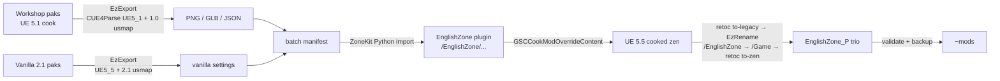

# English Zone — port to S.T.A.L.K.E.R. 2 v2.1.0 (UE 5.5)

[English Zone](https://steamcommunity.com/sharedfiles/filedetails/?id=3526187391) (Steam Workshop
3526187391, last updated 2025-10-23) replaces Cyrillic signage with English art. It was cooked for
game 1.x on **UE 5.1** and does nothing on 2.1.0 (**UE 5.5.4**). This port re-creates all of it
from the original cooked data. No source assets were ever available.

**Result (2026-11-10):** 471 assets ported (399 textures, 8 material instances of which 7 are new, 64 static
meshes with full Nanite geometry and collision). Shipped as a single `~mods\EnglishZone_P` trio
(1.66 GB) and confirmed in-game. The 3 `TranslateLens` packages (a separate plugin) are out of scope.

The original Workshop payload is not in this repo. With the item unsubscribed, point
`$env:ENGLISHZONE_ARCHIVE` at an archived copy of its `Content\Paks\Windows` folder.

## Pipeline



One command, resumable at any step:

```powershell
.\scripts\build-englishzone-all.ps1 [-From export-mod|export-vanilla|manifest|import|cook|idmod|validate|deploy] [-Deploy]
```

| Step     | Script                                                              | Gate                                                              |
| -------- | ------------------------------------------------------------------- | ----------------------------------------------------------------- |
| export   | `export-englishzone.ps1` → `tools/EzExport`                         | asset counts; re-stages the payload from the archive              |
| manifest | `make-englishzone-batch-manifest.ps1` (+ `strip-glb-extra-uvs.ps1`) | 0 errors; unsupported collision/settings are errors               |
| import   | `run-import-englishzone-batch.ps1` → `import-englishzone-batch.py`  | `EZ_BATCH_DONE fail=0` (log markers, not exit codes)              |
| cook     | `cook-englishzone.ps1`                                              | `BUILD SUCCESSFUL`, no translation failures                       |
| idmod    | `build-englishzone-idmod.ps1`                                       | every package renamed, kept == expected                           |
| validate | (in orchestrator)                                                   | package count == plugin assets; only new `MI_*` lack a vanilla ID |
| deploy   | `deploy-englishzone.ps1`                                            | game closed; previous trio backed up                              |

## Preserving the original art

| Area                              | Hurdle                                                                                              | Resolution                                                                                                                                                                                                                                     |
| --------------------------------- | --------------------------------------------------------------------------------------------------- | ---------------------------------------------------------------------------------------------------------------------------------------------------------------------------------------------------------------------------------------------- |
| **Textures**                      | Exports are post-LOD-bias mips; wrong group, sRGB or compression changes the look                   | Copy every setting (LODGroup, sRGB, VT streaming, compression, filter) from the _vanilla_ asset at the same path; `lod_bias=0`. Use vanilla path casing (the mod has `Textures/decals` vs `textures/decals`).                                  |
| **Mesh geometry**                 | Exports of the Nanite meshes came out as valid but **empty** 160-byte GLBs. No error anywhere.      | UE ≤ 5.2 Nanite clusters carry no tangents → zero tangent → NaN after normalize → SharpGLTF silently drops every vertex. EzExport now synthesizes tangents and enables `ReadNaniteData`.                                                       |
| **Material slots**                | Unresolved MI imports collapse every slot to `None`, which merges sections (e.g. sign body + bulbs) | Name GLB materials from `StaticMaterials` slot names, and resolve old-cook imports by package-ID hash against vanilla (`--names`). Slot-name guessing was proven wrong (`SM_uni_world_map_e`).                                                 |
| **Lighting / emissive**           | Bulb letters are geometry with an emissive slot; the fallback LOD drops them                        | Keep the bulbs as their own material section through Nanite cook (40 clusters carry the emissive range). Lightmap UV1 / res 64 preserved; extra UVs stripped.                                                                                  |
| **New materials**                 | The mod adds 7 font MIs that don't exist in vanilla                                                 | Recreated as new `MI_sign_font_02_*` children of vanilla parents; params read back to verify (setter return values are unreliable).                                                                                                            |
| **Collision**                     | Interchange generated generic collision; ZoneKit can't edit collision headless                      | Inject the mod's exact convex hulls into the GLB as `UCX_<mesh>_NN` nodes; import with `collision` + `import_collision_according_to_mesh_name` + `combine_static_meshes`. Box collision is added post-import. Counts verified from `agg_geom`. |
| **Material imports after repack** | `retoc to-legacy` nulled material imports, so meshes rendered as the gray checkerboard              | Zen imports are package-ID hashes; stage the vanilla containers that hold the referenced MIs (hardlinked) so names resolve.                                                                                                                    |

## Moving 5.1 assets to UE 5.5

### What failed, in order

1. **No `.uplugin`.** The Workshop payload never mounted at all.
2. **Stale container header** (`OptionalSegmentPackages` vs `SoftPackageReferences`). Mounted with `NumPackages=0`.
3. **Plain legacy `.pak` override.** Mounts, but a cooked IoStore game resolves packages only through the package store. No effect.
4. **Restamped zen container.** Registers 476 packages, but under `/EnglishZone/...` IDs that sit _beside_ vanilla, not over it.
5. **Splicing back the original `PackageRedirects`.** Overrides work, then a fatal error on the async loader. The 5.5 loader misreads 5.1 unversioned export data. This was confirmed twice: a byte-identical 5.1 payload through the clean identity route also fails ("Bad export index").
6. **Recook path, first attempt.** `PackageRedirects` overrides of assets with bulk data crash on 2.1 ("resize TArray to invalid size"). The loader reads texture bulk bytes as a struct.

**What works:** recook in ZoneKit (UE 5.5.4, matching the game). Then rename `/EnglishZone/*` → `/Game/*` inside the cooked packages, so their package IDs _equal_ vanilla's (identity collision, zero redirects). Ship loose in `~mods` with a `_P` suffix so the mod's higher mount order wins.

### Does it generalize?

| Lesson                                                                                                                                                                                                        | Scope                                                |
| ------------------------------------------------------------------------------------------------------------------------------------------------------------------------------------------------------------- | ---------------------------------------------------- |
| Cooked UE assets are tied to their engine version. Repackaging or restamping fixes containers, never payloads. **Across engine versions, extract → re-import → recook.**                                      | Any UE4/5 game                                       |
| Unversioned properties need the usmap of the game version that _cooked_ the asset (1.0-era usmap for the mod, 2.1 usmap for vanilla). A wrong usmap gives plausible garbage, not errors.                      | Any UE game with unversioned serialization           |
| Pick the parser version by A/B: round-trip a _vanilla_ asset as a control. The mod only parsed as `UE5_1`.                                                                                                    | Any UE game; any converter                           |
| Zen package ID = hash of the package path, so you can override a vanilla asset by cooking at its exact `/Game` path. Imports are hashes too: stage every container you reference before converting to legacy. | All IoStore (UE 5.x) games                           |
| Nanite from UE 5.0–5.2 has no tangents; synthesize them, or exports come out silently empty.                                                                                                                  | Any 5.0–5.2 Nanite source (CUE4Parse/FModel exports) |
| Carry custom collision through glTF as `UCX_` nodes.                                                                                                                                                          | Any UE 5.x Interchange import                        |
| Copy import settings from the target game's own asset at the same path, not from defaults.                                                                                                                    | General                                              |
| Trust structural checks (counts, hashes, read-back), not success messages or exit codes. ZoneKit, retoc and SharpGLTF all reported success on bad output.                                                     | General                                              |
| ZoneKit specifics (can't save under `/Game`; Python can't set or read hidden texture groups; no StaticMeshEditorSubsystem headless; benign `C0000374` on quit), GSC cook config, `~mods` order.               | S.T.A.L.K.E.R. 2 only                                |

The general recipe is: **extract with the source version's mappings → re-import with the target
game's own settings → recook on the target engine → match vanilla package identity.** It applies to
any UE game with a mod SDK or matching editor. Without an editor for the target engine version
there is no recook path. That is the hard limit.

## Known limitations

- Variants for empty (null) material slots were inferred. The cafe and bus-station templates matched only 68% and 73%.
- An empty HUE mask falls back to the template value or the parent default.
- `bSupportPhysicalMaterialMasks` can't be set from Python (6 meshes left at default).
- `RefractionDepthBias` and a few switches don't exist on the 2.1 parents and were dropped.
- `T_dev_oko_N` keeps the importer's texture group (WorldNormalMap expected, not readable from Python).
- The menu's "Mod Conflicts Detected" notice lists the identity override. This is expected.
